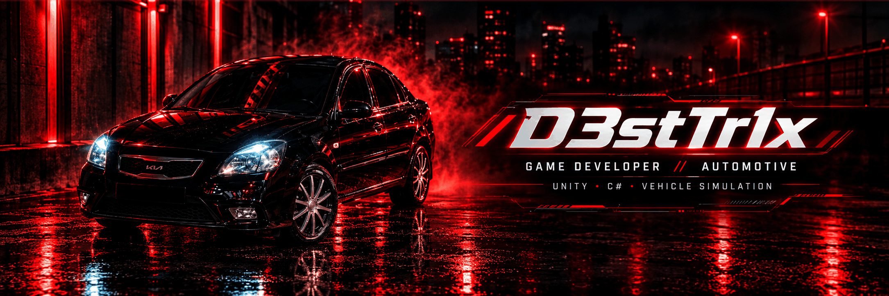
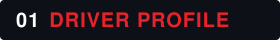
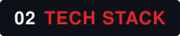
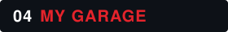
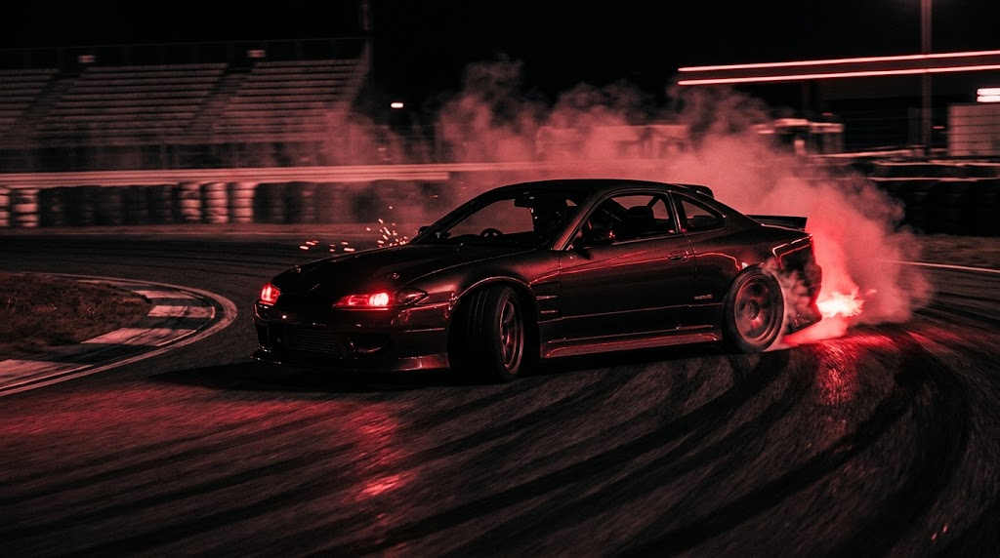
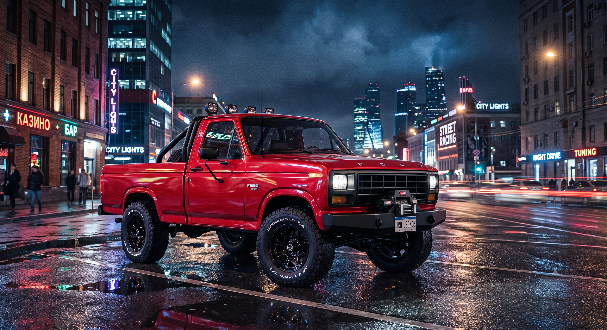
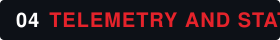

 

  

   

  

   

  
  
  
  

    

  
  
  

---

<h2>
  
</h2>

**ENGINE** 

**LANGUAGE** 

**FOCUS** `Gameplay` · `Vehicle Physics`

**INTERESTS** `JDM` · `Drifting` · `Simulation`

**OBJECTIVE** Turning ideas into playable worlds.

<h2>
  
</h2>

  

   

  **`01 / GAME DEVELOPMENT`**

  

   

  
  

    

  **`02 / PROGRAMMING LANGUAGES`**

  

   

  
  
  
  

    

  **`03 / DEVELOPMENT TOOLS`**

  

   

  
  

    

  

<h2>
  
</h2>

###  Autosim

**VEHICLE SIMULATION / UNITY / C#**

Building a driving experience focused on vehicle control, handling, and drifting mechanics.

  

   

  

**CORE SYSTEMS**

- Vehicle handling and driving mechanics
- Automotive gameplay and simulation
- Drifting-focused driving experience

---

###  HaulerGame

**TRUCKING SIMULATION / UNITY / C#**

A private game development project centered on trucking, transportation, and simulation gameplay.

  

   

  
  

**PROJECT FOCUS**

- Trucking and transportation gameplay
- Simulation-oriented game systems
- Building an immersive driving experience

*Source code is private.*

<h2>
  
</h2>

  

   

  

  

    

  

   

  

<h2>
  
</h2>

  

   

  ### `LIFE IS BETTER SIDEWAYS.`

  

